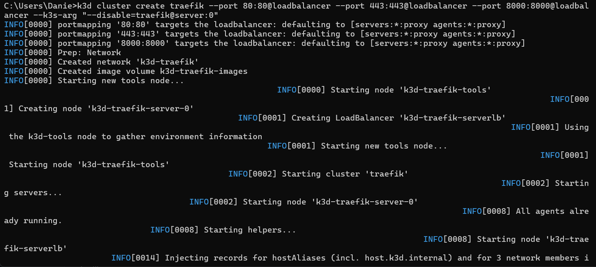
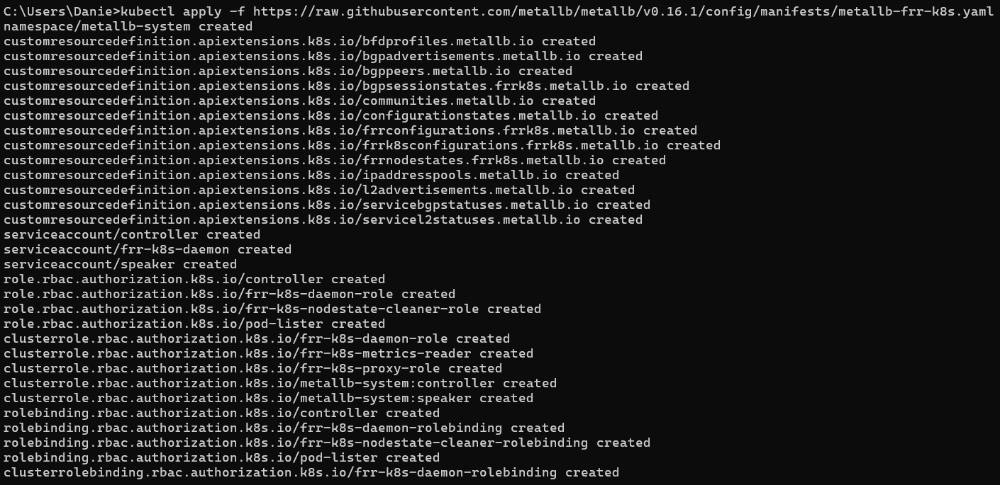
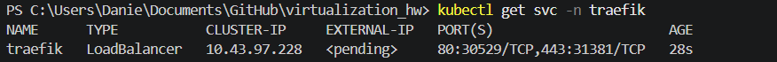
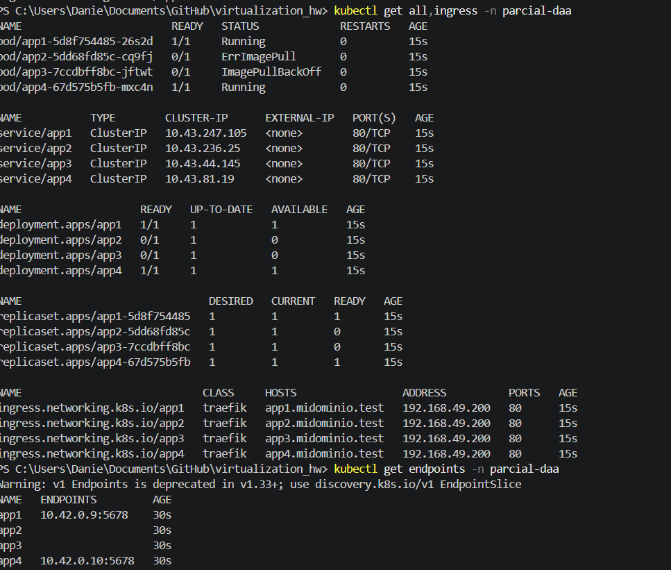
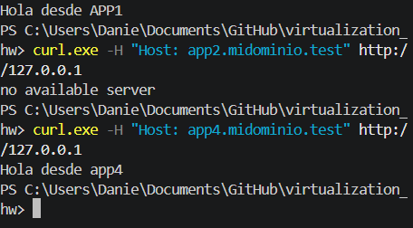

# Treafik installation

# Metallb installation

# Metallb config

# Traekfik working

# Apply -f apps/

# App response from command line

MetalLB asigna 192.168.49.200 dentro de la red de Minikube. Como uso Windows con driver Docker, esa red no es accesible desde el host, por lo que utilicé minikube tunnel y apunté el hosts de Windows a 127.0.0.1.