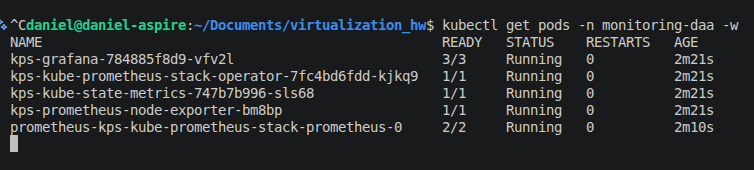
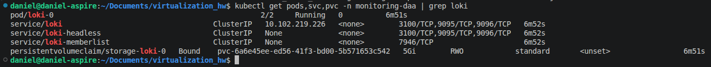
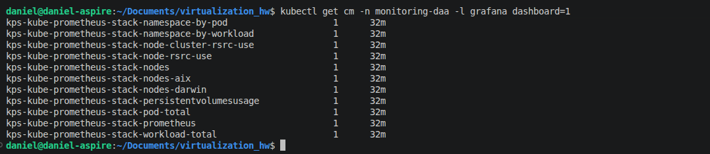
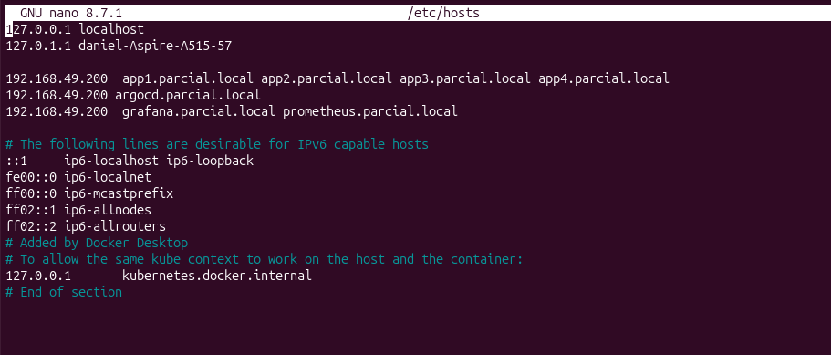
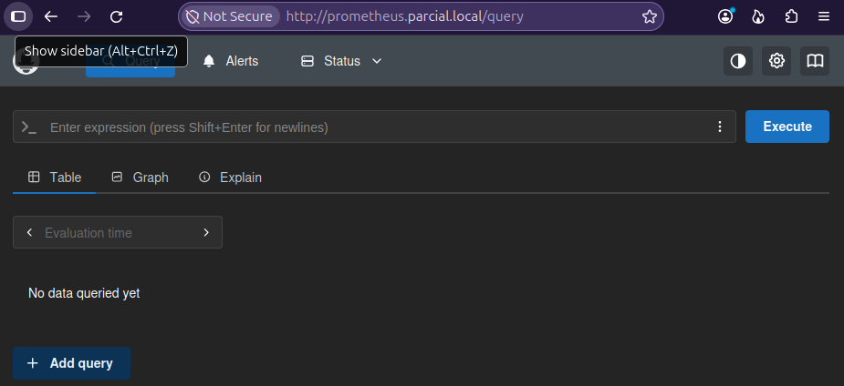
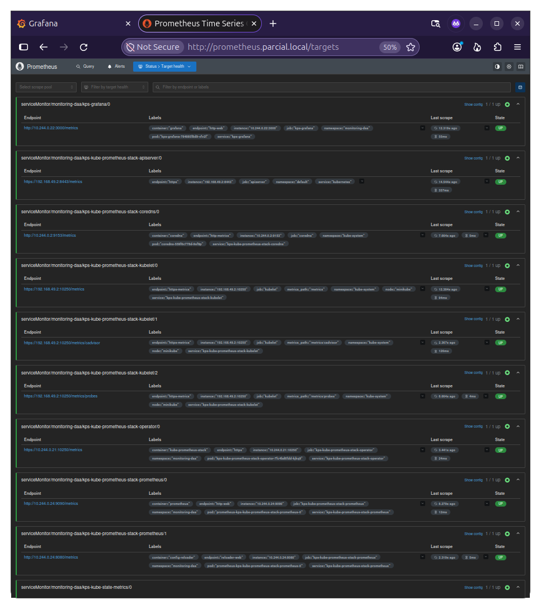
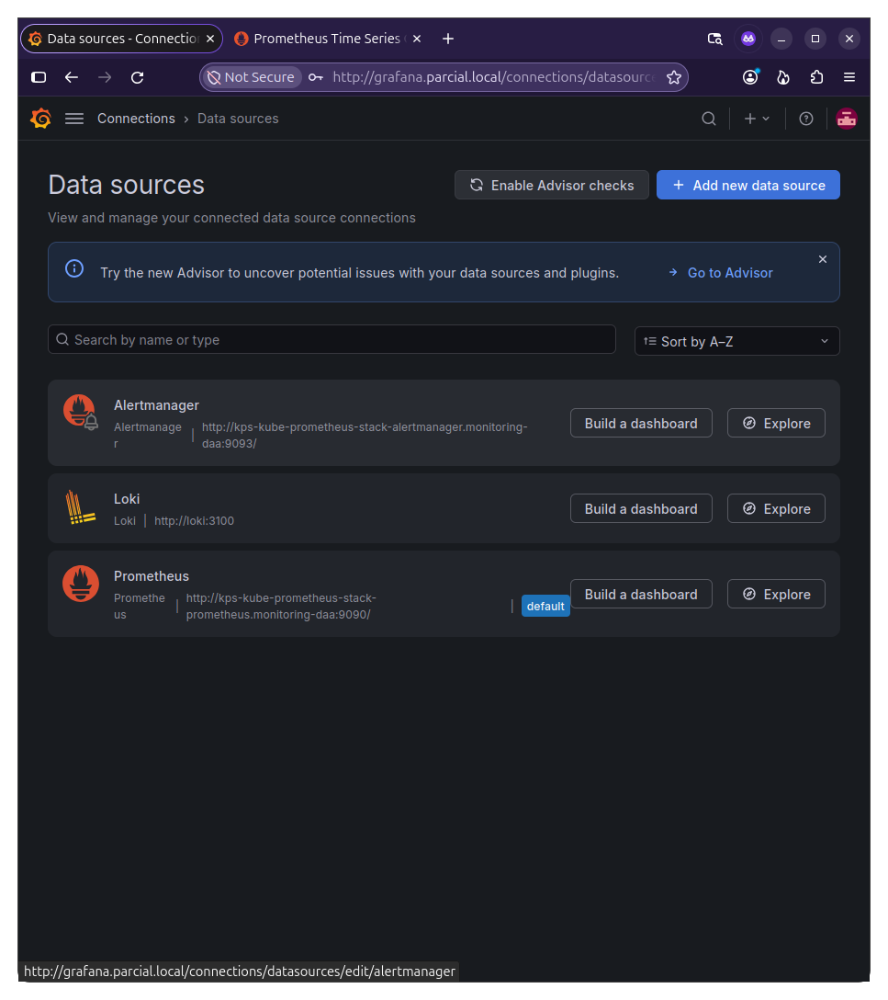
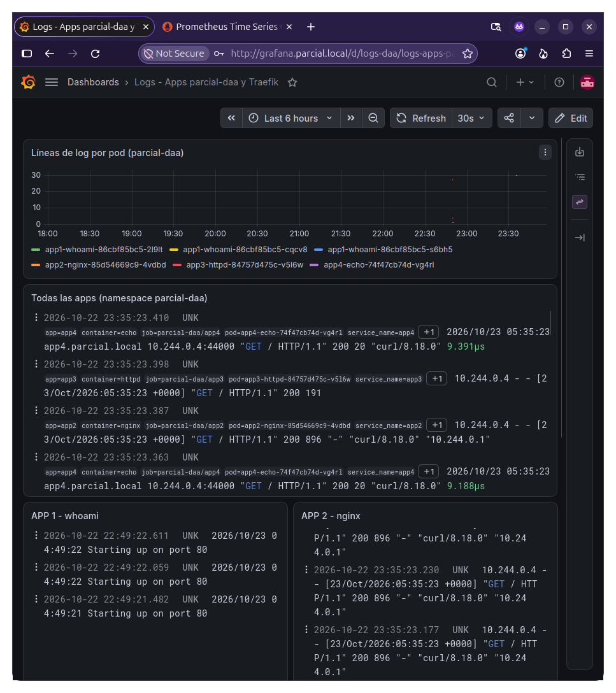
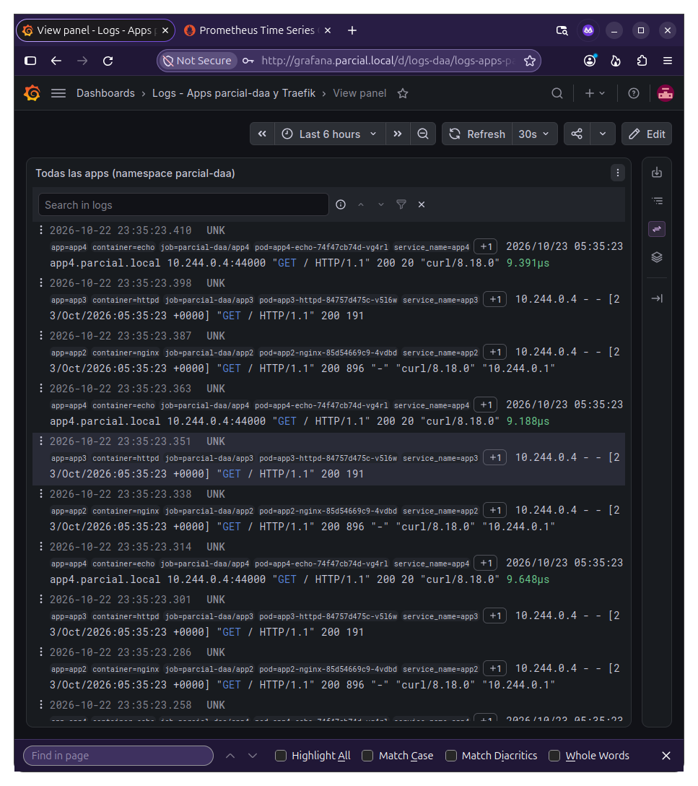
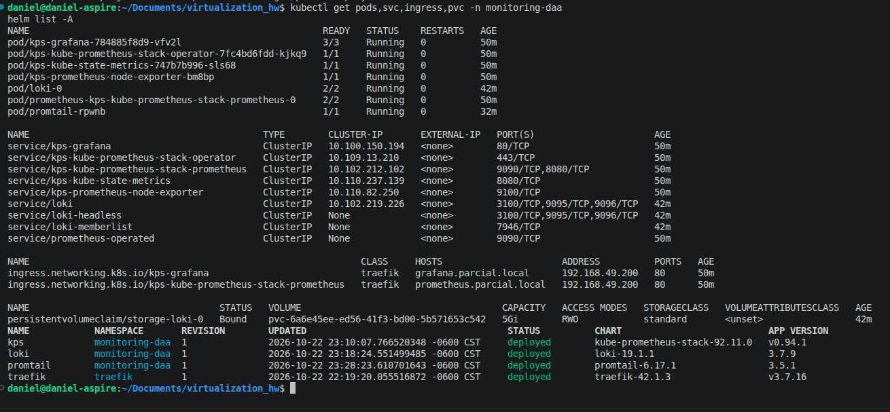

# Namespaces
S

# monitoring-daa pods

# loki pods running

# confimaps

# dns hosts

# grafana and prometheus dns

# prometheus dashboard

# prometheus target

# grafana login 

# grafana data sources

# grafanas metrics dashboard

# grafanas logs

# grafanas all apps logs

# Grafana, Prometheus, Loki and Promtail Running and charts versions
