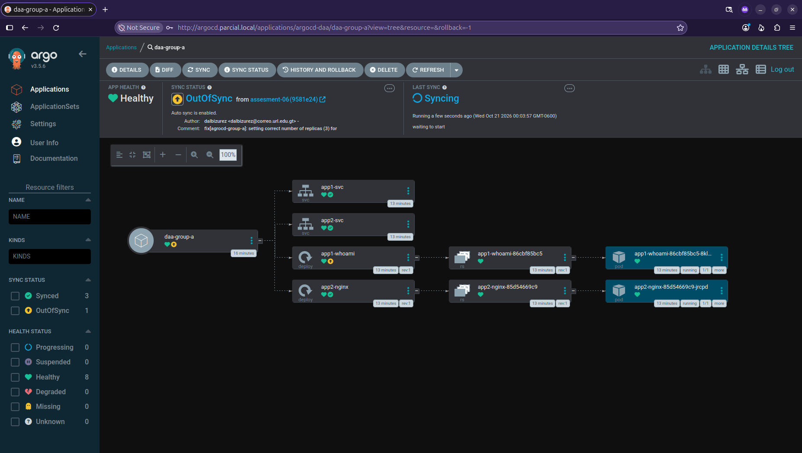
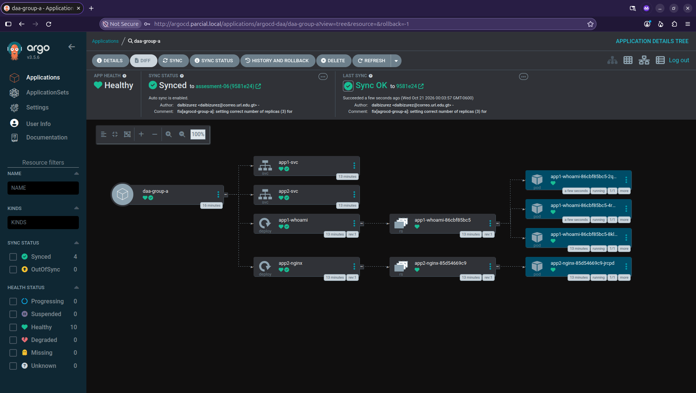
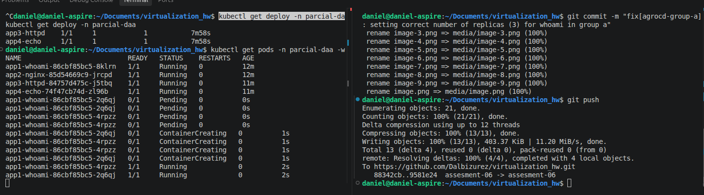
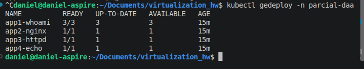

# argocd installation

# argocd pods and services running

# configured namespaces

# argocd ingress apply and result

## etc/hosts ip addition

# argocd login

### argocd dashboard

### argocd succesful repo connection

# argocd applications

# argocd application group a

### kubectl responses

## 3 replicas commit (wrong)

# replicas in agrocd (wrong)

### what should have shown 3 replicas

# agrocd sync (Correct) 

## updated agrocd 

## kubectl live changes

## 3/3 whoami replicas (Correct)
